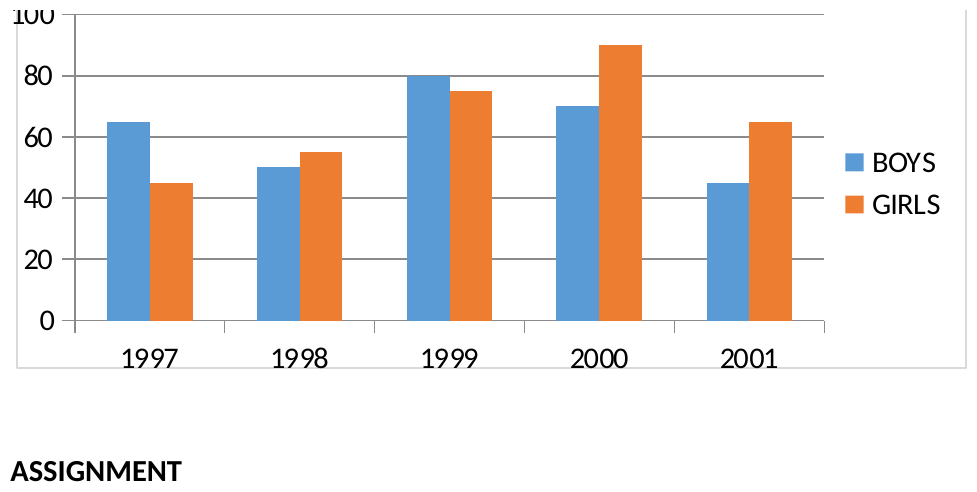
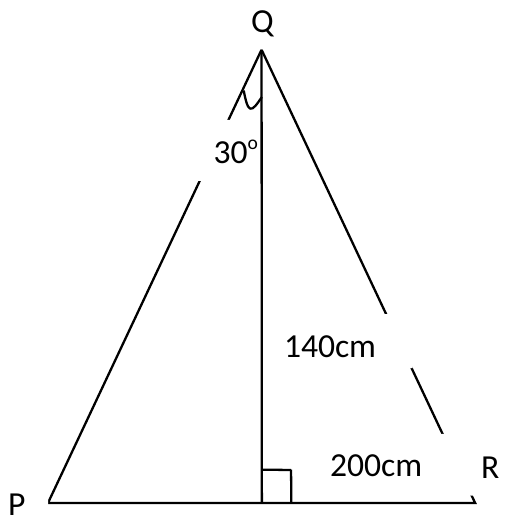
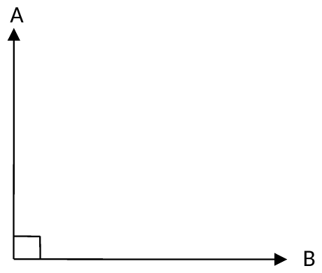

# D1 teacher decision sheet: JSS 3 Mathematics (3 questions)

Base master `02e596e8e53e1beea7a4b4b0aa52ba9308638a4d`. Evidence: `docs/jss3/completion/V2_MATH/` (REPORT.md, VISUAL_REGISTER.csv) and `scripts/jss3/v2/v2_math_figures.json`.
Status: **no teacher answer is recorded yet. Nothing has been implemented.** Crops below are the V2 recovered figures (LibreOffice renders of scratch copies; not checked in Word).

Teacher: ______________________ (name/role only; no contact details in Git)  Date: __________

## 1. Girls' admissions: chart or table? (M1-F07, 1st Term, EVERYDAY STATISTICS, `chart2.xml`, paragraph 523)

| Year | 1997 | 1998 | 1999 | 2000 | 2001 |
|---|---|---|---|---|---|
| Boys (chart and table agree) | 65 | 50 | 80 | 70 | 45 |
| Girls, plotted in chart | 45 | 55 | 75 | 90 | 65 |
| Girls, school table | 46 | 55 | 73 | 92 | 64 |

Differs in four years (1997, 1999, 2000, 2001). (The registered figure caption says "three years"; the data and test say four.)
What changes: the girls' value in each year, the girls' difference from boys (1999: 80-75 = 5 by chart, 80-73 = 7 by table), and totals. The year of highest girls' admission is 2000 either way (90 or 92).
Current delivery: newly prepared answers use the table values and are labelled so; the chart is shown as printed.
Tick one: [ ] table is correct  [ ] chart is correct  [ ] other: __________

## 2. Undefined point S in the assignment triangle (M2-F06, 2nd Term, APPLICATION OF TRIGONOMETRIC RATIOS, paragraphs 441-444)

Figure: QS 140 cm (right-angle mark), SR 200 cm, 30 degrees between QP and the vertical. The foot of the vertical is unlabelled; the question refers to S.
If S is the foot of the perpendicular: angle QRS = arctan(140/200) = 35.0 degrees; PR = 140 tan 30 + 200 = 280.8 cm. This is the only reading used now, as a labelled assumption.
What changes: both answers (angle QRS and PR). A different position for S gives different numbers; the teacher must say where S is.
Tick one: [ ] S is the foot of the vertical  [ ] S is elsewhere (describe): __________

## 3. Intended bearing-example wording (M2-F08, 2nd Term, BEARINGS, paragraphs 502-505)

Printed sentence: "The bearing of point A from B is 090 degrees". Drawing: A is due north and B due east of an unlabelled corner. From the drawing, B from the corner is 090; A from the corner is 000. The sentence's "A from B" would be a bearing in the north-west quadrant (315), so sentence and drawing disagree.
What changes: the worked answer and any bearing/back-bearing reasoning built on this example. Example 2 (arrow drawn at 225, labelled 210) is separate and is not part of this decision.
Tick one: [ ] "B from the corner (O) is 090"  [ ] "A from B is ___"  [ ] other wording: __________

## Source excerpts, checked against the supplied inputs ZIP
`SOURCE_INVENTORY.csv`: 39 documents, every sha256 matches. `JSS 3 MATHEMATICS.docx` = `861fa300...88be9`, `BASIC 9 MATHEMATICS E-NOTE.docx` = `1292fe87...f5db` (both identical to the V2 record). Locators below count every `w:p` in `word/document.xml` in document order (text boxes included).
- **Item 1 (1st Term, paragraphs 510-521):** "The following table shows the number of candidates who gained admission into higher institutions at a certain town over a period of years." Table rows Year/Boys/Girls: 1997 65 46; 1998 50 55; 1999 80 73; 2000 70 92; 2001 45 64. Then "Illustrate this information on dual bar chart"; questions include "How many more boys had admission than girls in 1999?" The source's own table gives girls 46, 55, 73, 92, 64, so the plotted values (45, 55, 75, 90, 65) are the embedded chart's data, which sits at the "SOLUTION" (paragraphs 522-523).
- **Item 2 (2nd Term, paragraphs 445-461):** the figure text reads "200cm", "140cm", "30o" with labels P, R; the question is "Calculate angle QRS" followed by "PR". No paragraph text defines S.
- **Item 3 (2nd Term, paragraphs 503-508):** "Examples of bearings using three digits" ... "The bearing of point A from B is 090o".
- **Locator note:** V2's register cites 441-444 (item 2) and 502-505 (item 3); in this count the same content is at 445-455/461 and 503-508, so V2's numbers are off by a few paragraphs. The content matches; use the text above, not the old numbers, when applying an answer. The 1st Term locator (523) agrees.

## Rules for applying answers
Only a ticked, dated answer is implemented, and only for its own item; unticked items keep the current labelled-assumption text. A decision does not close the unrelated open items (equilateral-triangle exercise, T formula, U+2205 symbol, superscripts). Source text is not edited; corrections go in separate labelled teaching with provenance "teacher decision, [date], [role]".
